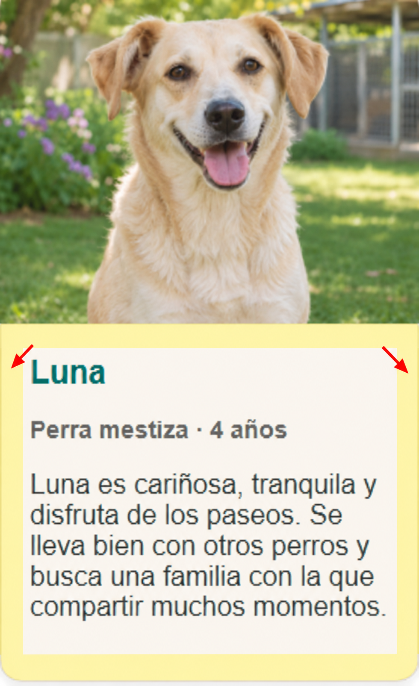

# Rúbrica de evaluación — Huellas Felices

La calificación total es de **10 puntos**. Cada criterio permite obtener puntuación parcial cuando el resultado está comenzado o incompleto.

| Criterio evaluable | Puntuación completa | Puntuación parcial | Máximo |
|---|---|---|---:|
| Cabecera | Se aplica correctamente el color `#2f6f61` y existe espacio interior para que el título y el menú no queden pegados a los bordes | La cabecera tiene un color de fondo reconocible o alguno de sus elementos presenta separación respecto al borde | 0,50 |
| Título y menú de la cabecera | **Huellas Felices** y los tres elementos del menú son blancos, legibles y están visiblemente separados | Se distingue el título y aparece al menos parte del menú con separación | 0,50 |
| Color de los títulos y nombres | **Animales en adopción** y **Contacta con nosotros** usan `#24564b`, y los nombres de los cuatro animales usan `#2f6f61` | El color adecuado se aplica a los títulos de sección o al menos a un nombre de animal | 0,50 |
| Color y grosor de los datos de los animales | Las cuatro líneas descriptivas de raza y edad, como **Perra mestiza · 4 años**, usan el color `#6b5e50` y un grosor de fuente `700` | El color o el grosor `700` se aplica correctamente al menos a una de esas líneas | 0,50 |
| Etiquetas semánticas | Se utilizan cinco o más etiquetas semánticas diferentes | Se utilizan entre dos y cuatro etiquetas semánticas diferentes | 0,50 |
| Imágenes de los animales | Se ven correctamente las cuatro imágenes | Se ve correctamente al menos una imagen | 0,50 |
| Sintaxis HTML | El HTML no contiene ningún error de sintaxis | No se concede puntuación parcial: si existe algún error de sintaxis, se obtienen 0 puntos | 0,25 |
| Textos alternativos | Las cuatro imágenes tienen un atributo `alt` adecuado | Al menos una imagen tiene un `alt` adecuado | 0,50 |
| Enlace del cuarto animal | El enlace funciona, lleva a la ficha correcta y se abre en una pestaña nueva | El enlace existe y lleva a la ficha, pero falta algún detalle de apertura | 0,50 |
| Separación entre animales | Los cuatro animales aparecen en tarjetas claramente separadas | Al menos dos animales se distinguen visualmente como elementos separados | 0,50 |
| Comportamiento en pantalla estrecha | Los animales terminan colocándose uno debajo de otro al reducir la pantalla | Las tarjetas cambian de fila, aunque no lleguen a una única columna | 0,75 |
| [Espacio interior de las tarjetas](#apoyo-visual-espacio-interior-de-las-tarjetas) | Existe separación clara entre todo el contenido y el borde de cada tarjeta | El espacio interior se aprecia en algunas tarjetas o en parte del contenido | 0,50 |
| Imagen de fondo | Se inserta `images/animal-pattern-50.png`, se repite y se muestra con tamaño `50px 50px` | Existe una imagen de fondo, aunque falte ajustar la repetición o el tamaño | 0,50 |
| Pie de página | Existe el footer con el texto completo, legible y alineado en el centro | Existe un pie de página o aparece parte del texto solicitado, aunque no esté centrado | 0,50 |
| Presentación de las tarjetas | Todas las tarjetas usan el fondo `#f7f3ec`, tienen una anchura máxima de `250px`, borde y esquinas redondeadas | Al menos dos tarjetas presentan el fondo indicado o parte del tratamiento visual solicitado | 0,50 |
| Distribución y espaciado general | El contenido está bien distribuido, centrado y con separaciones consistentes | Se aprecia organización y separación en alguna de las secciones | 0,50 |
| Formulario: controles | Aparecen nombre, correo, mensaje y botón de envío | Aparecen al menos dos de esos elementos | 0,50 |
| Formulario: etiquetas y tipos | Los tres campos tienen etiquetas asociadas y utilizan controles apropiados. Al hacer clic sobre la etiqueta de cada campo, el control asociado recibe el foco y permite escribir en él | Al menos un campo tiene etiqueta asociada y tipo apropiado; al hacer clic en su etiqueta, el control recibe el foco y permite escribir en él | 0,50 |
| Formulario: campos obligatorios y límites | Nombre, correo y mensaje son obligatorios y respetan sus límites máximos: 60, 254 y 500 caracteres respectivamente | Al menos uno de los campos es obligatorio y respeta el límite indicado | 0,50 |
| Formulario: envío | `action` contiene el endpoint indicado y se utiliza `method="post"` | Está configurado correctamente `action` o `method`, pero no ambos | 0,50 |
| **TOTAL** |  |  | **10,00** |

## Apoyo visual: espacio interior de las tarjetas

En la siguiente imagen, la zona amarilla representa el espacio interior del bloque de texto situado debajo de la fotografía. La imagen ocupa todo el ancho de la tarjeta; el relleno se aplica al contenido textual para separarlo de los bordes laterales e inferior.

## Aplicación de la puntuación parcial

Como orientación general, la puntuación parcial equivale a la mitad del máximo del criterio. Por ejemplo:

- Mostrar las cuatro imágenes obtiene 0,50 puntos.
- Mostrar entre una y tres imágenes obtiene 0,25 puntos.
- No mostrar ninguna imagen obtiene 0 puntos.

La misma lógica se aplica siempre que el criterio permita dividir razonablemente el resultado.

El criterio **Sintaxis HTML** es una excepción: se otorgan **0,25 puntos únicamente si el HTML no contiene ningún error de sintaxis**; en caso contrario, se otorgan **0 puntos**.

